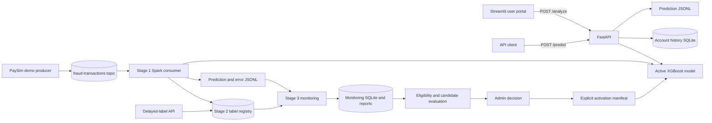

# Transaction Fraud Detection System

An academic fraud-scoring prototype built with synthetic PaySim transactions. The repository contains two XGBoost model versions, a FastAPI inference service, a Streamlit user/admin interface, a Kafka and Spark streaming path, drift monitoring, delayed-label audit storage, guarded candidate evaluation and activation tools, and model explanation utilities.

> **Project limitation:** PaySim is synthetic. The model scores are offline results on simulator-generated labels, not evidence of performance on real bank transactions. Genuine verified labels are not configured in the checked-in environment, so real retraining eligibility is blocked.

## Contents

- [Project purpose](#project-purpose)
- [Implemented capabilities](#implemented-capabilities)
- [Architecture](#architecture)
- [Data and feature contract](#data-and-feature-contract)
- [Models and evaluation](#models-and-evaluation)
- [Transaction prediction](#transaction-prediction)
- [API](#api)
- [Streaming](#streaming)
- [Monitoring and drift](#monitoring-and-drift)
- [Delayed labels and data quality](#delayed-labels-and-data-quality)
- [Retraining and model orchestration](#retraining-and-model-orchestration)
- [Synthetic simulation demonstration](#synthetic-simulation-demonstration)
- [Explainability](#explainability)
- [Streamlit dashboard](#streamlit-dashboard)
- [Storage and artifacts](#storage-and-artifacts)
- [Repository layout](#repository-layout)
- [Installation](#installation)
- [Run the application](#run-the-application)
- [Tests](#tests)
- [Limitations and future work](#limitations-and-future-work)
- [Security and responsible use](#security-and-responsible-use)
- [Project information](#project-information)

## Project purpose

The project demonstrates how a fraud-scoring workflow can preserve prediction-time feature boundaries, handle an imbalanced classification target, collect outcome labels later, monitor feature distributions, and restrict model changes to an auditable review process. The pieces are connected for local academic demonstrations; they do not form a production banking service.

Project objectives:

- Build a chronological transaction feature pipeline that excludes target leakage.
- Serve transaction risk estimates through an API and a role-based local dashboard.
- Demonstrate Kafka/Spark event scoring and persistence of prediction evidence.
- Keep delayed-label provenance, drift alerts, candidate evaluation and human model activation auditable.
- Show simulation workflows separately from genuine-label retraining and real-world evaluation.

## Implemented capabilities

- Binary transaction scoring with an XGBoost classifier and a saved decision threshold.
- Strict 34-feature ordering shared by model artifacts and prediction paths.
- FastAPI request validation, persistent account-history features, idempotency handling, and prediction logging.
- Streamlit role-based user and admin views.
- Kafka event ingestion with Spark Structured Streaming micro-batch scoring; a local file bridge is available for the older Phase 7 implementation.
- SQLite prediction/label registry and an auditable label submission API.
- Statistical feature drift checks, optional verified-label performance checks, and persisted monitoring evidence.
- Readiness gates, isolated candidate training/evaluation, administrator review, and manifest-based model activation utilities.
- SHAP and bounded counterfactual analysis utilities.

Monitoring alerts do not automatically train or activate a model. Synthetic demonstration candidates remain separate from real-candidate lifecycle records.

## Architecture



The FastAPI process and current Stage 1 consumer resolve and load their model at startup. Restart them after changing model selection. The repository also has an earlier notebook-oriented streaming path (`src/streaming/spark_streaming.py`) that imports the API pipeline; the Stage 1 runner (`src/streaming/stage1_streaming.py`) is the current integration that uses the Stage 2 registry.

## Data and feature contract

The source is the [PaySim synthetic financial dataset](https://www.kaggle.com/datasets/ealaxi/paysim1). The local workflows expect `data/raw/PS_20174392719_1491204439457_log.csv`. The CSV contains 6,362,620 simulated transactions and columns such as `step`, `type`, `amount`, sender/receiver identifiers and before/after balances, `isFraud`, and the simulator's `isFlaggedFraud` field. The target is `isFraud`.

The models consume the following ordered 34 numeric features:

```text
hour_of_day, amount, log_amount, is_large_amount,
amount_to_sender_balance_ratio, amount_ge_sender_balance, sender_remaining_if_debited,
amount_to_dest_balance_ratio, sender_balance_before, sender_balance_zero_before,
dest_balance_before, dest_balance_zero_before,
sender_prev_txn_count, sender_prev_total_amount, sender_prev_mean_amount, sender_prev_max_amount,
dest_prev_txn_count, dest_prev_total_amount, dest_prev_mean_amount, dest_prev_max_amount,
amount_vs_sender_hist_mean, amount_vs_dest_hist_mean,
sender_hours_since_prev_txn, dest_hours_since_prev_txn,
dest_txn_count_last_1h, dest_txn_count_last_24h, dest_txn_count_last_168h,
dest_amount_sum_last_24h, dest_amount_sum_last_168h,
type_CASH_IN, type_CASH_OUT, type_DEBIT, type_PAYMENT, type_TRANSFER
```

`step` is a simulated hour and supports chronology/feature calculation; `event_id` is a stable row identity for audit/label matching. Neither is a model input. `isFraud` is the target and is excluded from prediction messages, features, and drift inputs. Post-transaction balances (`newbalanceOrig`, `newbalanceDest`) are accepted only for compatibility in the prediction schema and are not used for scoring. Feature engineering uses before-transaction values, type indicators, amount ratios, and historical sender/destination activity. History features use only earlier stored transactions. The exact order and frozen feature-engineering parameters are recorded in model metadata and `reports/feature_engineering_summary.json`.

The class is highly imbalanced. Training uses chronological partitions rather than random shuffling, XGBoost `binary:logistic`, `aucpr` evaluation, a large `scale_pos_weight`, early stopping, and a validation-selected classification threshold. V2 reuses the V1 feature contract.

## Models and evaluation

| Version | Meaning | Threshold | Current status |
|---|---|---:|---|
| V1 | Original baseline trained on the earlier chronological window | 0.60 | Available for rollback/comparison |
| V2 | Retrained model on the expanded chronological dataset | 0.53 | **Currently selected** |
| Simulation candidates | Separate artifacts produced by demonstration workflows | Varies | Not active unless an eligible, reviewed candidate is explicitly promoted |

There is no `models/active_model_manifest.json` in the inspected workspace. The shared resolver therefore uses `FRAUD_ACTIVE_MODEL_VERSION` when set, otherwise defaults to V2. A valid activation manifest, if created by the promotion workflow, takes precedence. The API and Stage 1 stream load the selected bundle once at process startup.

V2 training used 5,382,204 PaySim-derived rows: 7,649 fraud and 5,374,555 legitimate. Its chronological split used 5,015,193 training rows (through step 422), 185,387 validation rows (through step 565), and 181,624 held-out test rows (through step 743; 1,956 fraud). The V2 threshold of 0.53 was selected by maximum validation F1.

The table compares both model artifacts on the **same V2 held-out test split**, using each version's saved threshold. It does not mix the separate simulation demonstration results into the model evaluation.

| Model | Threshold | Precision | Recall | F1 | PR-AUC | ROC-AUC | TP / TN / FP / FN |
|---|---:|---:|---:|---:|---:|---:|---:|
| V1 | 0.60 | 0.991820 | 0.991820 | 0.991820 | 0.998165 | 0.999927 | 1,940 / 179,652 / 16 / 16 |
| V2 | 0.53 | 0.998468 | 0.999489 | 0.998978 | 0.999490 | 0.999682 | 1,955 / 179,665 / 3 / 1 |

V1's original, separate held-out test report has precision 0.976459, recall 0.994009, F1 0.985156, PR-AUC 0.994588, and ROC-AUC 0.999952 (threshold 0.60; 918,617 test rows). These are not directly comparable to the same-split table above. PR-AUC is useful with rare fraud because it summarizes precision/recall behavior for the positive class and is less dominated by the large number of legitimate transactions than accuracy can be.

These high metrics are on synthetic PaySim data and should not be interpreted as real-world performance or calibrated real-bank probabilities. Source reports: [`model_v1_metrics.csv`](reports/model_v1_metrics.csv), [`model_v2_training_report.json`](reports/model_v2_training_report.json), and [`model_v1_vs_v2_comparison.json`](reports/model_v1_vs_v2_comparison.json).

## Transaction prediction

The user portal asks for the simulated time step, transaction type, amount, sender and receiver references, and each party's balance before the transaction. It does not ask the user to supply model history features. The API calculates amount/time/balance/type features and looks up earlier events stored for those account references. The current transaction is scored before it is added to persistent history. History supplied to this local application is not linked to an external bank account.

The result includes a fraud probability, `risk_score = fraud_probability × 100`, risk band, model version, and a threshold-based binary prediction. Probability and class are different outputs: the probability is the model score; the class is `1` when the score is at least the selected threshold (V2 currently 0.53). Risk bands are LOW (0–30), MEDIUM (30–70), and HIGH (70–100) on the percentage risk score.

## API

Start the API with `uvicorn src.api.app:app`. Interactive OpenAPI documentation is available at `/docs`.

| Method and path | Purpose |
|---|---|
| `GET /` | Service and loaded model version |
| `GET /health` | Model-loaded status, version, feature count, threshold |
| `POST /predict` | Return prediction fields and append a prediction log record |
| `POST /analyze` | Score and return the exact ordered feature row plus account-history status |
| `POST /state/preview` | Preview features using earlier persisted history, without adding the transaction |
| `POST /state/warmup` | Add explicitly supplied prior events to account history, without scoring |
| `POST /state/reset` | Reset volatile state; persistent account history is preserved |

Prediction request example (same schema used by `/predict` and `/analyze`):

```json
{
  "step": 5,
  "type": "TRANSFER",
  "amount": 1500.0,
  "nameOrig": "C1234567890",
  "oldbalanceOrg": 5000.0,
  "nameDest": "C9876543210",
  "oldbalanceDest": 0.0,
  "isFlaggedFraud": 0
}
```

Required fields are `step` (integer >= 1), `type` (one of CASH_IN, CASH_OUT, DEBIT, PAYMENT, TRANSFER), `amount` (>= 0), `nameOrig`, `oldbalanceOrg` (>= 0), `nameDest`, and `oldbalanceDest` (>= 0). `isFlaggedFraud` is optional (default 0). Optional post-transaction balances are accepted for raw-row compatibility and ignored. Unknown fields are rejected; `isFraud` is not an allowed request field. An optional `Idempotency-Key` header supports safe retry of identical requests; reuse with different content returns 409.

Typical `/predict` response:

```json
{
  "prediction": 0,
  "fraud_probability": 0.12,
  "risk_score": 12.0,
  "risk_level": "LOW",
  "model_version": "V2"
}
```

Values above are illustrative response-shape examples, not a recorded prediction. `/analyze` adds `feature_names`, `features`, and `history_status`. Validation errors use FastAPI/Pydantic responses; idempotency conflicts return 409, unavailable account history 503, invalid feature values 400, and unexpected inference errors return a generic 500 response. The prediction API has no authentication layer in the implementation and should be bound to loopback for local demonstrations.

## Streaming

The current Stage 1 flow publishes synthetic PaySim events to Kafka topic `fraud-transactions` at `127.0.0.1:9092`. Events contain transaction ID, step, type, amount, account references and before/after balances; they do not contain `isFraud`. A Spark Structured Streaming consumer validates and sorts each micro-batch by step/sequence, computes the shared features, and scores with the active model bundle. It appends prediction/error JSONL and status evidence under `data/stage1_streaming/`, and registers prediction results in the Stage 2 SQLite store.

The streaming state is process-local and the topic is configured for one partition so event chronology and account histories are handled consistently. Spark also uses a persistent checkpoint. Run one consumer only against that checkpoint; restarting or replaying can have at-least-once behavior, so append outputs may contain duplicates in an interrupted write/checkpoint window. The producer repeatedly replays a finite synthetic slice with fresh demo IDs; it does not generate new underlying transactions.

`src/streaming/spark_streaming.py` and `src/streaming/kafka_producer.py` retain the earlier Phase 7 workflow. That producer supports `auto`, `kafka`, and `local_bridge`; auto mode clearly reports when it falls back to writing local JSON files. It requires the raw CSV. The Stage 1 consumer specifically requires a reachable Kafka broker, Java/JDK for Spark, the Kafka connector, and Windows `winutils.exe` support where applicable. Kafka binaries are not installed by `tools/kafka.tgz`; it is only an archive.

## Monitoring and drift

Stage 3 compares a deterministic sample from the model's training-period reference data with recent logged feature vectors. It checks numeric feature distributions with PSI and Kolmogorov–Smirnov tests, binary proportions with proportion tests, adjusts p-values using Benjamini–Hochberg, and applies an overall drift-rate threshold. It excludes `isFraud`, `step`, and `event_id`. The report and feature-level evidence, alerts, and retraining requests are stored in `data/stage3/monitoring.sqlite3` and exposed through the Drift & Alerts dashboard page.

Where authorized genuine delayed labels exist, the monitor can compare precision, recall, and F1 against the saved held-out baseline at the model threshold. The current workspace has no configured trusted genuine-label source, so genuine-label performance monitoring is unavailable. Thresholds and minimum cohort sizes are provisional; observed drift is distribution evidence, not proof that model quality fell. A drift result/request does not trigger training.

The current saved report includes a historical synthetic comparison and must not be described as live production drift. The monitoring runner persists a new observation; it is not a read-only health command.

## Delayed labels and data quality

The optional Stage 2 delayed-label API accepts a transaction ID, outcome (`fraud` or `legitimate`), source name, source type (`trusted_verified`, `untrusted`, or `synthetic_test`), timezone-aware confirmation time, and unique submission ID. It links label submissions to registered prediction IDs, with `event_id` as the dataset-wide mapping key in the historical label collection workflow. Pending unmatched labels, duplicate identical submissions, conflicting labels, rejected submissions, and replayed submission IDs are recorded for audit.

`trusted_verified` submissions require an allowlisted `FRAUD_TRUSTED_LABEL_SOURCES` entry and a private `FRAUD_TRUSTED_LABEL_TOKEN` sent as `X-Label-Token`. Synthetic-origin predictions are rejected for trusted verification. Existing PaySim `isFraud` values collected as delayed labels are explicitly simulated labels, not genuine investigative outcomes. No genuine source/token is configured in the inspected environment, and synthetic labels do not qualify for retraining.

The label API endpoints are `GET /health`, `GET /stats`, `GET /predictions/{transaction_id}`, `GET /labels/{transaction_id}`, `GET /submissions/{transaction_id}`, and `POST /labels`. It runs separately from the prediction API.

## Retraining and model orchestration

The repository has both earlier Stage 4–6 workflow utilities and a newer optional orchestrator in `src/orchestrator/`, exposed in the Model Orchestrator admin page. The newer lifecycle reports model readiness, checks saved drift evidence and label eligibility, creates a candidate dataset only after gates pass, trains a candidate into an isolated run directory, evaluates it against the active model on held-out data, records an administrator review decision, and requires an explicit promotion operation to update the active-model manifest. Evaluation or approval alone does not activate a model. The activation resolver validates the manifest, artifact hashes, version, threshold, and exact feature ordering; activation is loaded by serving processes only after restart.

Eligibility requires a valid active model, saved unambiguous drift evidence, a configured/authorized trusted source, correctly matched genuine verified labels (minimum policy floor 100), no unresolved/rejected labels, unmatched labels or conflicts, and strict provenance verification. Candidate training also rejects synthetic/PaySim label provenance. In the inspected workspace `data/orchestrator_runs/` does not exist, no active manifest exists, and no real orchestrator candidate/review/promotion evidence is present. Genuine retraining is therefore blocked. These restrictions are intentional safeguards, not proof a candidate was trained or approved.

The earlier Stage 4 workflow has its own eligibility report and stricter minimum of 100 verified labels including at least 10 fraud labels. Stage 5 separates candidate validation, review, activation and rollback. These utilities are operator-driven; drift does not start them automatically.

## Synthetic simulation demonstration

The Model Orchestrator page can run a drift simulation using generated, synthetic labels and controlled feature shifts. It saves candidate model artifacts and drift/evaluation/recommendation reports under `models/drift_simulation/` and `reports/drift_simulation/`. Another bounded demonstration workflow is under `src/retraining/simulation_demo.py` with evidence in `reports/simulation_demo/`.

A simulation recommendation means only that a candidate may be worth human review within that synthetic experiment. It does not establish real fraud detection performance or make the model eligible for genuine activation. The workflow keeps candidates separate, records integrity checks, and is explicitly designed not to modify V2, the real orchestrator run history, or active-model selection; automatic promotion is prohibited. Simulation metrics must not be combined with V1/V2 held-out metrics.

## Explainability

`src/xai/explain_v2.py` generates global and local SHAP evidence for V2, with saved example artifacts under `reports/xai_v2/`. The Counterfactual Explainability page can look up a stored transaction by exact `event_id` in the processed V2 Parquet data, score the row with the currently resolved model, display local SHAP contributions, and search a bounded set of amount/type changes for a hypothetical threshold-crossing example. The user portal also presents a safe explanation from the exact analyzed feature vector.

SHAP values describe how the model's features move its output relative to a baseline; they do not establish the cause of a real transaction or prove fraud. Counterfactual search is approximate, constrained to selected input changes, and does not guarantee the globally smallest or realistic change. It is a model-sensitivity demonstration, not evasion advice.

## Streamlit dashboard

Launch `dashboard.py` to open the role-aware interface. The public navigation offers Welcome, Sign in and Sign Up. A registered user sees **Transaction Risk Check**. The admin navigation currently registers these pages:

| Page | Purpose |
|---|---|
| Admin Overview | Summary of local system activity and evidence |
| Transaction Analyzer | Admin transaction form and API analysis |
| Transaction Explorer | Browse available transaction/prediction records |
| Counterfactual Explainability | Inspect SHAP and bounded hypothetical changes for a selected stored event |
| Pipeline Evidence | Review streaming outputs and pipeline evidence |
| Drift & Alerts | Inspect saved monitoring results, feature evidence and alerts |
| Delayed Labels | Inspect label readiness, provenance and submission records |
| Model Performance | Review saved model metrics and prediction performance evidence |
| Model Orchestrator | Inspect readiness and run the isolated simulation/review/activation tools |
| System Health | View local service and storage health evidence |
| System Architecture | Explain component relationships and current workflow state |
| Reports & Documentation | Browse project reports and documentation |

The former Live Monitoring page is currently registered as **Pipeline Evidence**. The Retraining Lab source file exists but is not in the active admin navigation.

Authentication is role-aware: regular accounts are registered in local SQLite; admin sign-in requires `FRAUD_ADMIN_USERNAME` and `FRAUD_ADMIN_PASSWORD_HASH` configured in the process environment or Streamlit secrets. Password hashes use PBKDF2-SHA256. This is local project access control, not an enterprise identity system.

## Storage and artifacts

| Location | Contents |
|---|---|
| `data/account_history.sqlite3` | Prior transaction events and prediction/idempotency records for API feature history |
| `data/user_accounts.sqlite3` | Local registered user accounts (password hashes, not plaintext passwords) |
| `data/stage2/prediction_labels.sqlite3` | Prediction registry, label submissions, provenance and conflict audit |
| `data/stage3/monitoring.sqlite3` | Monitoring runs, feature evidence, alerts and retraining requests |
| `data/stage1_streaming/` | Current Stage 1 prediction/error JSONL and stream status |
| `models/` | V1/V2 models, metadata, thresholds, active bundle copies and separate candidate/simulation artifacts |
| `reports/` | Offline evaluation, monitoring, explainability and integration evidence |
| `checkpoints/` | Spark Structured Streaming offsets/state; preserve when restarting the same stream |

The raw and processed datasets, local databases, virtual environment, checkpoints, and some candidate artifacts are git-ignored or local. Check their presence before running relevant workflows. The repository's tests use temporary state for their fixtures; this README task did not run those tests or any mutating workflow.

## Repository layout

```text
dashboard.py             Role-aware Streamlit entry point
pages/                   User portal and active Streamlit admin pages
ui/                      Authentication and shared dashboard components
services/                 API client, data access, user and counterfactual explanations
src/api/                  FastAPI inference and persistent account-history store
src/streaming/            Kafka producers and Spark consumers
src/labels/                Delayed-label API, validation and SQLite store
src/drift/                 Distribution drift calculations
src/monitoring/            Persisted Stage 3 monitoring workflow
src/orchestrator/          Readiness, training, evaluation, review and promotion records
src/retraining/            Earlier Stage 4–6 lifecycle and simulation workflows
src/xai/                   SHAP explanation generation
models/                    Model artifacts, metadata, thresholds and candidates
notebooks/                 EDA, feature engineering, training, streaming and drift notebooks
reports/                   Metrics, validation evidence, figures and simulation reports
data/                      Local datasets and SQLite/JSONL state (some files ignored)
docs/                      Stage guides, runbook, workflow and results documentation
tests/                     unittest coverage for API, dashboard and workflow safeguards
requirements.txt           Core/model/API/streaming dependencies
requirements-ui.txt        Optional Streamlit dependencies
```

## Installation

The project documentation records a Windows PowerShell setup using Python 3.12. The current checkout contains a local virtual environment, but it is ignored and should not be copied as a dependency source. From a fresh clone:

```powershell
git clone <repository-url>
Set-Location <repository-directory>
python -m venv .venv
.\.venv\Scripts\Activate.ps1
python -m pip install -r requirements.txt
python -m pip install pyarrow
python -m pip install -r requirements-ui.txt
```

`pyarrow` is commented as optional in the requirements file but is needed for Parquet-based workflows. `requirements.txt` does not declare Uvicorn even though the existing environment has it; install/check it separately before starting FastAPI (`python -m pip install uvicorn`). The streaming workflow additionally needs a local Kafka broker, Java/JDK, and the Spark Kafka connector; these are not installed by the Python requirements. On Windows, Spark expects the included `tools/hadoop/bin/winutils.exe` helper.

The PaySim raw CSV and processed Parquet files are local data inputs and may be absent from a fresh clone because `data/raw/` and `data/processed/` are git-ignored. Obtain the dataset from its source and place it at the expected path. Do not commit private credentials, secrets, local customer data, or generated databases.

For admin dashboard access, configure `FRAUD_ADMIN_USERNAME` and a valid PBKDF2-SHA256 `FRAUD_ADMIN_PASSWORD_HASH` in environment or Streamlit secrets. Genuine label submission configuration uses `FRAUD_TRUSTED_LABEL_SOURCES` and `FRAUD_TRUSTED_LABEL_TOKEN`; configure these only for a genuinely authorized label source. Without them, genuine-label functionality remains unavailable.

## Run the application

### Streamlit dashboard

```powershell
python -m streamlit run dashboard.py
```

For transaction scoring, start the FastAPI service separately first.

### FastAPI prediction service

```powershell
$env:FRAUD_ACTIVE_MODEL_VERSION = 'v2'
python -m uvicorn src.api.app:app --host 127.0.0.1 --port 8000
```

Visit `http://127.0.0.1:8000/health` or `http://127.0.0.1:8000/docs`. The process creates/uses `data/account_history.sqlite3` and appends prediction records under `reports/` by default. Those are persistent writes. For a disposable local run, set `FRAUD_PREDICTION_LOG_PATH` to a temporary file. Set model version before process start; restart after changing it.

### Kafka and Spark Stage 1

The current Stage 1 integration needs a running Kafka broker at `127.0.0.1:9092`, topic `fraud-transactions` with one partition, Java, Spark's Kafka connector, and the expected raw PaySim CSV. In separate PowerShell windows, start exactly one consumer, then optionally start its synthetic producer:

```powershell
$env:FRAUD_ACTIVE_MODEL_VERSION = 'v2'
python -m src.streaming.stage1_streaming
```

```powershell
$env:FRAUD_ACTIVE_MODEL_VERSION = 'v2'
python -m src.streaming.stage1_producer --delay 2
```

The producer runs continuously until Ctrl+C. The consumer uses a persistent checkpoint and writes JSONL/database state; these commands are not read-only. Do not run multiple consumers concurrently against the same checkpoint. Detailed broker setup and safe restart notes are in [`docs/DEMO_RUNBOOK.md`](docs/DEMO_RUNBOOK.md) and [`docs/STAGE1_STREAMING.md`](docs/STAGE1_STREAMING.md).

The earlier bounded producer can instead use `python -m src.streaming.kafka_producer --num-transactions 20 --mode auto`; its auto mode may fall back to the local file bridge. Do not confuse that bridge with a live Kafka broker.

### Delayed-label API and monitor

The label API is optional and writes to the Stage 2 database on startup/submission:

```powershell
python -m uvicorn src.labels.api:app --host 127.0.0.1 --port 8769
```

The monitor CLI persists a new monitoring observation and should only be run when that write is intended:

```powershell
python -m src.monitoring.cli --model-version V2
```

See the [demo runbook](docs/DEMO_RUNBOOK.md) for lifecycle commands and their write effects. Real candidate creation remains blocked unless all genuine-label and provenance gates pass.

## Tests

The test suite uses Python's `unittest` and includes API/account-history contracts, UI authentication/navigation, streaming/monitoring validation, label rules, candidate evaluation, promotion safeguards, and simulation behavior. From the repository root:

```powershell
python -m unittest discover -s tests -p "test_stage*.py" -v
python -m unittest discover -s tests -v
```

These commands are provided from the repository's documented runbook. They were not executed during this README update. Passing unit tests do not demonstrate external Kafka availability, production capacity, or real-world model performance.

## Limitations and future work

- PaySim data and its fraud labels are synthetic and may not reflect real fraud patterns.
- The API has no authentication; keep it local and do not expose it as an internet-facing service.
- Account history is local SQLite and feature state is process-local; the single-partition stream is not a horizontally scaled design.
- The streaming producer repeats a finite dataset slice; output/checkpoint handling can be at-least-once.
- No genuine verified label provider is configured. Genuine retraining and genuine-label performance evaluation are currently blocked.
- Drift floors and acceptance policies are academic/provisional, not production-calibrated.
- The newer orchestrator has no real run history or activated candidate in the inspected workspace. Simulation candidates are not production candidates.

Future work includes authorized investigation/chargeback label integration, representative evaluation cohorts, calibrated operating thresholds, robust distributed account-history state, live service/load testing, and operational security review.

## Security and responsible use

The API validates types, ranges, and supported categories; rejects unknown fields (including `isFraud`); protects retries with idempotency keys; and avoids returning internal exception details for unexpected inference failures. Label provenance is separated by source type, trusted submission is allowlisted/token-gated, and synthetic-origin events cannot be marked trusted verified. Candidate activation is separated from evaluation and review, with artifact/manifest integrity validation.

Dashboard authentication protects pages by user/admin role, but local account registration and one environment-configured administrator are not a substitute for a hardened identity provider. Do not expose credentials, private tokens, real customer identifiers, or data in reports. Model predictions and explanations are decision-support demonstrations only; a score is not proof of fraud and must not by itself determine adverse action against a person.

## Project information

No author name, institution, or contact details were confirmed in the inspected repository, so none are listed here. See [`docs/PROJECT_PRESENTATION.md`](docs/PROJECT_PRESENTATION.md) for the presentation outline and [`docs/PROJECT_RESULTS_AND_LIMITATIONS.md`](docs/PROJECT_RESULTS_AND_LIMITATIONS.md) for a fuller discussion of evaluation evidence and limitations.

## Detailed documentation

The root README is the project overview. For deeper workflows, see the [dashboard guide](DASHBOARD_README.md), [user guide](docs/UI_USER_GUIDE.md), [Windows demo runbook](docs/DEMO_RUNBOOK.md), [system workflow](docs/PROJECT_WORKFLOW.md), [results and limitations](docs/PROJECT_RESULTS_AND_LIMITATIONS.md), and [controlled drift simulation](docs/DRIFT_SIMULATION.md). Stage-specific notes cover [streaming](docs/STAGE1_STREAMING.md), [labels](docs/STAGE2_LABELS.md), [monitoring](docs/STAGE3_MONITORING.md), [real retraining gates](docs/STAGE4_RETRAINING.md), [candidate promotion and rollback](docs/STAGE5_MODEL_PROMOTION.md), and [the separate Stage 6 demonstration](docs/STAGE6_RETRAINING_DEMONSTRATION.md).
