# Project workflow and system architecture

This guide describes the current implemented connections and their limits. Prediction is served separately from delayed labels and monitoring. Monitoring evidence does not automatically start candidate training, and candidate evaluation does not automatically activate a model.

## Architecture

```mermaid
flowchart LR
  subgraph prediction[Prediction and inference]
    source[PaySim demonstration source] --> producer[Stage 1 producer]
    producer --> kafka[(Kafka: fraud-transactions)] --> spark[Spark Structured Streaming]
    spark --> validate[Validate and order micro-batch]
    client[Streamlit or REST client] --> api[FastAPI /predict or /analyze]
    validate --> builder[Shared feature builder]
    api --> builder
    builder --> state[Past-only account history]
    state --> model[Resolver-selected XGBoost model]
    resolver[Active-model resolver at process start] --> model
    model --> apiout[API response and prediction log]
    model --> streamout[Stage 1 prediction/error JSONL]
    streamout --> registry[(Stage 2 prediction registry)]
  end
  subgraph feedback[Delayed outcomes and monitoring]
    submitter[Authorized label submitter] --> labelapi[Stage 2 label API]
    labelapi --> registry
    streamout --> monitor[Stage 3 monitor]
    registry -->|eligible genuine labels only| monitor
    reference[V1/V2 training-window reference] --> monitor
    monitor --> evidence[(Stage 3 runs, alerts, requests)]
  end
  subgraph lifecycle[Separate model lifecycle]
    evidence --> readiness[Readiness and eligibility checks]
    registry --> readiness
    readiness -->|only after genuine-label gates pass| candidate[Separate candidate artifacts]
    candidate --> evaluation[Candidate evaluation]
    evaluation --> review[Human review decision]
    review -->|separate authorized promotion| manifest[Activation manifest and audit]
    manifest -. restart serving processes .-> resolver
    manifest --> rollback[Explicit guarded rollback]
    sim[Isolated synthetic drift simulation] --> simcandidate[Simulation-only candidate and reports]
  end
```

The current Stage 1 Spark consumer imports the FastAPI feature/model pipeline, validates events, orders them within a batch, writes prediction/error/status records and registers successful predictions in Stage 2. The Kafka topic is configured for one partition because account-state history is process-local. The configured checkpoint is `checkpoints/stage1_kafka_spark`; only one consumer should use it at a time. The older Phase 7 modules and notebook workflow remain in the repository but should not be confused with the current Stage 1 integration.

FastAPI `/predict` returns the compact prediction response; `/analyze` also returns ordered features and history status for the user portal. Both use the same active-model resolver as Stage 1. Without a manifest, V2 is the default unless `FRAUD_ACTIVE_MODEL_VERSION` chooses V1. The current workspace has no active manifest. Processes resolve/load the selected bundle at startup, so a promotion requires process restart.

`isFraud` is the supervised target, never an inference feature. `event_id` is a transaction identity and `step` a time-ordering field; neither is in the 34-feature model vector. Account history uses prior transaction data only. Stage 1 state remains process-local and begins empty after a full consumer restart.

## Delayed labels and monitoring

Stage 2 records predictions and later label submissions, including source type, authorization, unmatched/pending state, duplicates and conflicts. Synthetic-origin predictions cannot be accepted as trusted verified. Stage 3 reads feature evidence and only computes labeled performance from eligible trusted verified labels. Its drift alerts and retraining requests are persisted evidence, not training commands.

The saved label environment has no configured genuine trusted source or token and no eligible genuine verified cohort. PaySim `isFraud` labels and synthetic simulation labels do not satisfy this requirement.

## Real candidate lifecycle

There are two related guarded workflows in the repository:

- The historical Stage 4/5 path checks genuine labels, builds a candidate when explicitly invoked and eligible, evaluates it, and supports separate approval, promotion and rollback commands.
- The newer `src/orchestrator/` package records readiness, run, dataset, training, evaluation, administrator decision and promotion evidence in separate run directories. Its promotion service binds approval to candidate/report/active-artifact state and updates the resolver manifest only after revalidation.

The Orchestrator page exposes readiness, review/promotion for an existing qualifying run, and the simulation demonstration. Its real candidate-start action is currently disabled. No real orchestrator run directory or promoted candidate is present in the inspected workspace. The current genuine-label gate therefore blocks actual real retraining in this setup. Code support for guarded training/evaluation is not evidence that an eligible real candidate exists or has been trained.

Stage 6 and the controlled drift demonstration are separate synthetic workflows. The Stage 6 demonstration trains from historical PaySim `isFraud` labels. The drift simulation generates new labels from a constructed rule and compares its candidate with V2 on those labels. Both are demonstration-only and barred from genuine promotion.

## Current evidence status

| Capability | Repository evidence and limit |
|---|---|
| FastAPI prediction and validation | Implemented; unit and historical integration evidence exist. A code path does not guarantee a running server. |
| Kafka-to-Spark Stage 1 | Implemented; historical broker-backed evidence exists. It requires an external broker, Java/Spark connector, data, and persistent checkpoint. |
| Stage 2 delayed labels | Implemented local API/SQLite workflow. No trusted genuine source is configured in the inspected setup. |
| Stage 3 drift/performance | Implemented separately; saved windows are synthetic and labeled performance is insufficient without eligible labels. |
| Guarded real retraining/promotion | Modules and tests implement checks/actions, but current eligibility is blocked and there is no real orchestrator run or promotion evidence. |
| Synthetic candidate demonstrations | Implemented and saved separately; results are not real fraud-performance evidence and cannot promote. |

See [the Windows runbook](DEMO_RUNBOOK.md), [results and limitations](PROJECT_RESULTS_AND_LIMITATIONS.md), [Stage 1](STAGE1_STREAMING.md), [Stage 2](STAGE2_LABELS.md), [Stage 3](STAGE3_MONITORING.md), [Stage 4](STAGE4_RETRAINING.md), [Stage 5](STAGE5_MODEL_PROMOTION.md), [Stage 6](STAGE6_RETRAINING_DEMONSTRATION.md), and [controlled drift simulation](DRIFT_SIMULATION.md).
