# Project workflow and system architecture

This guide describes the implemented components and the hand-offs between them. Solid arrows in the diagram are the prediction/serving path; dashed arrows are delayed-label, monitoring, and model-lifecycle paths. The latter are separate operator workflows. Drift does not start training, and training does not automatically activate a model.

## Architecture

```mermaid
flowchart LR
  subgraph prediction[Prediction and inference path]
    pay[PaySim demo source]
    producer[Stage 1 producer]
    kafka[(Kafka: fraud-transactions)]
    spark[Spark Structured Streaming]
    validate[Event validation]
    features[Shared feature builder and process-local AccountState]
    resolver[Active-model resolver at process startup]
    model[XGBoost V2 default or selected V1]
    apiout[FastAPI response and configured API prediction log]
    streamout[Stage 1 prediction JSONL, errors, and status]
    client[REST client]
    api[FastAPI /predict and /health]
    pay --> producer --> kafka --> spark --> validate --> features
    client --> api --> features
    resolver --> model
    features --> model
    model --> apiout
    model --> streamout
    api -. health/model status .-> client
  end

  subgraph labels[Delayed labels and monitoring]
    labelclient[Authorized label submitter]
    labelapi[Stage 2 label API]
    labeldb[(Stage 2 SQLite)]
    reference[V1/V2 reference dataset]
    monitor[Stage 3 drift and performance monitor]
    monitorstore[(Stage 3 SQLite: runs, alerts, requests)]
    operator[Human operator/reviewer]
    labelclient -. later outcome .-> labelapi --> labeldb
    streamout -. registered prediction .-> labeldb
    streamout -. inference evidence .-> monitor
    labeldb -. eligible verified outcomes .-> monitor
    reference -. feature reference .-> monitor
    monitor --> monitorstore
  end

  subgraph lifecycle[Guarded offline model lifecycle]
    gate[Stage 4 genuine-label and data eligibility gates]
    candidate[Separate candidate artifacts]
    eval[Stage 5 candidate validation against active model]
    approval[Human approval bound to candidate and report]
    activate[Activation manifest and audit record]
    rollback[Explicit guarded rollback]
    demo[Stage 6 synthetic PaySim demonstration candidate]
    stage5block[Stage 5 rejects demonstration candidates]
    labeldb -. read-only labels .-> gate
    streamout -. exact feature vectors .-> gate
    monitorstore -. request evidence for review .-> operator
    operator -. deliberate manual invocation, not automatic .-> gate
    gate -. eligible and explicitly invoked .-> candidate
    candidate --> eval
    eval -. accepted candidate .-> approval --> activate
    activate -. after process restart .-> resolver
    activate --> rollback
    demo --> stage5block
  end
```

The Stage 1 Spark consumer imports the FastAPI feature builder and active model configuration; it validates each event, sorts records within a micro-batch, builds the ordered model vector, and records outputs. The topic is configured for one partition because account history is held in one process-local `AccountState`. Stage 1's configured checkpoint is `checkpoints/stage1_kafka_spark`; do not run concurrent consumers against it.

FastAPI `/predict` uses the same feature builder and model bundle loaded at application startup. `/health` reports the loaded model version, feature count, and threshold. Prediction calls update the process-local feature history and append to the configured prediction log. `isFraud` is never an inference feature; the request schema rejects it as an extra input.

Stage 1 registers predictions in Stage 2 after appending its JSONL output. Stage 2's label API accepts delayed outcomes, validates provenance and authorization, and retains the first label. Identical retries are idempotent; conflicts are audited without replacing the original label. A synthetic test label can test the workflow but can never qualify as `trusted_verified`.

Stage 3 runs independently. It compares feature vectors from the Stage 1 log with a model-specific training reference and calculates performance only from eligible joined trusted labels. It persists reports, alerts, and retraining requests. Those requests are evidence for a later review; they do not invoke Stage 4.

Stage 4 reads the Stage 2 label database read-only, Stage 1 prediction evidence, and the V2 historical training baseline. It does not subscribe to or automatically consume the Stage 3 request database; an operator must decide whether to invoke its eligibility workflow. It applies minimum eligibility requirements (currently at least 100 eligible verified labels and 10 verified fraud labels). Candidate training requires explicit invocation and is blocked when those gates are not met. Stage 5 evaluates a separate candidate and binds authorization to its artifacts and evaluation report before activation. Activation does not hot-reload a running API or Spark process; processes must be restarted to use a newly resolved bundle. Rollback is a separate guarded operation. Stage 3 currently has reference cohorts for V1 and V2, not arbitrary candidates.

Stage 6 is a bounded training demonstration using historical synthetic PaySim data. Its artifacts carry `training_mode=demonstration` and `eligible_for_genuine_promotion=false`; Stage 5 rejects them. This does not satisfy Stage 4's genuine-label requirements.

## Lifecycle status

| Step | Status and evidence |
|---|---|
| Event validation, feature generation, and model scoring | Implemented; covered by Stage 1 unit tests and historical Phase 12 service evidence. |
| Kafka-to-Spark processing | Implemented. Phase 12 has historical broker-backed evidence; Phase 13 did not repeat live Kafka/Spark. |
| API inference and health reporting | Implemented; Phase 12 recorded API checks. Phase 13 used tests and direct checks, not a running HTTP service. |
| Prediction and error recording | Implemented. Stage 1 uses append-only output/error JSONL plus a secondary Stage 2 prediction registry. |
| Delayed-label collection | Implemented as an operator-facing local API and SQLite store. No authorized genuine source is configured in the current project setup. |
| Drift/performance monitoring | Implemented separately from inference. The historical synthetic-only alert is not production evidence; Phase 13 did not run the persistent monitor. |
| Genuine retraining eligibility | Implemented and tested; current eligible genuine-label count is insufficient, so Stage 4 does not produce a genuine candidate. |
| Candidate evaluation, authorization, activation, rollback | Implemented as guarded offline operations and tested with temporary fixtures. No current candidate has been promoted. |
| Stage 6 demonstration | Completed on a bounded synthetic PaySim sample; candidate remains unpromoted and explicitly ineligible. |

For the operator commands and safety notes, see [DEMO_RUNBOOK.md](DEMO_RUNBOOK.md). For evidence and metric context, see [PROJECT_RESULTS_AND_LIMITATIONS.md](PROJECT_RESULTS_AND_LIMITATIONS.md).
